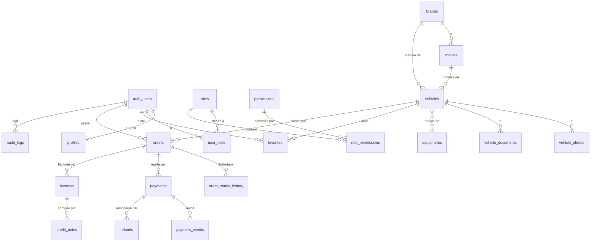

# 11 — Proposition d'architecture backend (Supabase + Vercel)

> **Statut : PROPOSITION — en attente de validation.** Aucune modification structurelle n'a été
> faite pour rédiger ce document. Les décisions à prendre sont regroupées en section 12.
> Rédigé le 2026-11-06 à partir de l'état réel du dépôt (branche `main`, commit `cf72e47`).

## 1. Résumé

L'architecture demandée (Next.js, Vercel, Supabase PostgreSQL / Auth / Storage) est **compatible**
avec le projet et **déjà à moitié en place** : le schéma de base, les politiques RLS, le stockage et
les clients Supabase existent. Ce qui manque est **l'authentification elle-même**, la
**protection des routes**, le **flux d'envoi des photos**, la **réservation anti-vente
simultanée** et la **chaîne d'environnements**.

Principes retenus :

1. **Trois lignes de défense, jamais une seule** : `proxy.ts` (filtre rapide) → vérification
   côté serveur dans chaque page, action et route (la vraie barrière) → RLS en base (dernier mur).
2. **Les rôles vivent dans nos tables**, jamais dans des données modifiables par l'utilisateur.
3. **Un seul chemin d'accès aux données côté serveur** (Drizzle, via une couche d'accès), Supabase
   servant à l'authentification et au stockage.
4. **La base garantit les règles critiques** (unicité de la vente, statuts valides), même si le
   code se trompe.

## 2. Examen de l'existant

| Domaine | État | Remarque |
|---|---|---|
| Framework | Next.js **16.2.1**, React **19.2.4**, TypeScript strict | Dépôt sain : types, lint, 49 tests, build passent |
| Supabase | `@supabase/ssr` 0.12.7, `@supabase/supabase-js` 2.119 | Clients serveur et navigateur écrits, **jamais utilisés** |
| Base | Drizzle + 4 migrations (`0000` contact ; `0001` catalogue, comptes, favoris ; `0002` automatismes et rôles ; `0003` stockage) | ✅ **Appliquées avec succès** sur le projet de développement le 2026-11-07 |
| RLS | Activée sur toutes les tables, vérifiée par un test automatique | Lecture publique limitée aux véhicules publiés |
| Auth | **Absente** | Aucune page, aucun `proxy.ts` |
| Storage | Deux espaces définis en SQL (photos publiques, documents privés) | Aucun flux d'envoi |
| Commandes, paiements, factures | **Non définis** | En attente de décisions métier (docs/08) |
| Environnements | Un `.env.example` | Rien pour *preview* ni *production* |

### Défauts relevés pendant l'examen (à corriger, sans urgence)

| # | Constat | Gravité | Correction proposée |
|---|---|---|---|
| E1 | `lireEnvServeur()` exige **toutes** les variables Supabase. Si seule `DATABASE_URL` est renseignée, `db()` lève une erreur : le contact et le catalogue échoueraient. | Moyenne (latent) | Découper le schéma d'environnement : base, clés publiques, clé de service |
| E2 | `src/lib/supabase/*.ts` utilisent `process.env.X!` : une variable absente donne une erreur obscure au lieu d'un message clair | Faible | Passer par le schéma validé |
| E3 | Aucun en-tête de sécurité (CSP, `X-Frame-Options`…) dans `next.config.ts` | Moyenne | Ajouter un jeu d'en-têtes (section 9) |
| E4 | Aucune limite de débit sur le formulaire de contact | Faible | À traiter avec la limitation de débit globale (section 5) |
| E5 | `.env.example` nomme les clés `anon` / `service_role` ; Supabase propose aujourd'hui un format « publishable / secret » | À vérifier | Confirmer dans le tableau de bord du projet (décision D8) |

## 3. Compatibilité Next.js 16 ↔ Supabase

| Point | Verdict | Détail |
|---|---|---|
| Versions | ✅ | `@supabase/ssr` 0.12.7 exige `supabase-js ≥ 2.114` ; installé : 2.119 |
| Node | ✅ | Node 22 (Vercel supporte 22 et 24) ; aucun `engines` déclaré (à ajouter) |
| `cookies()` asynchrone | ✅ | Déjà géré dans `src/lib/supabase/server.ts` |
| `middleware` → `proxy` | ⚠️ à respecter | Next.js 16 renomme `middleware.ts` en **`proxy.ts`** (runtime **Node.js** par défaut, l'option `runtime` n'existe plus) |
| Rafraîchissement de session | ⚠️ **obligatoire dans `proxy.ts`** | Les Server Components ne peuvent pas écrire de cookies : sans `proxy.ts`, le jeton expiré n'est jamais renouvelé et l'utilisateur est déconnecté au bout d'1 h |
| Vérification de l'identité | ✅ | `getClaims()` existe ; **ne jamais** se fier à `getSession()` côté serveur (la doc Supabase l'interdit : le cookie peut être falsifié) |
| Images distantes | ⚠️ à configurer | `next/image` exige `images.remotePatterns` pour l'adresse du Storage |
| Server Actions | ✅ | Protection CSRF native (comparaison de l'origine) ; rien à ajouter sur Vercel |
| Cache | ⚠️ | `unstable_cache` fonctionne mais Next.js 16 recommande `use cache` (décision T-11) |

Contrainte de Next.js à respecter (guide d'authentification, `node_modules/next/dist/docs`) :
`proxy.ts` s'exécute sur **chaque** route, **y compris les liens préchargés** ; il doit donc rester
léger (pas de requête SQL) et ne constitue **jamais** une protection suffisante à lui seul.

## 4. Architecture backend proposée

```
Navigateur
   │
   ▼
Vercel ── proxy.ts ─────────────  1. rafraîchit la session, redirige si pas de session (filtre rapide)
   │
   ▼
Next.js (pages, Server Actions, Route Handlers)
   │   src/lib/auth/      ──  2. LA vraie barrière : exigerUtilisateur(), exigerRole('administrateur')
   │   src/modules/*      ──  logique métier (jamais de règle dans les pages)
   │   src/lib/db/        ──  Drizzle (connexion directe, contourne la RLS)  → accès contrôlé par le code
   │   src/lib/supabase/  ──  Auth + Storage uniquement
   ▼
Supabase
   ├─ Auth        (identités, sessions, vérification d'e-mail, MFA)
   ├─ PostgreSQL  (données ; 3. RLS = dernier mur pour l'API publique)
   └─ Storage     (photos publiques, documents privés)
```

### Qui accède à quoi

| Chemin | Utilisé pour | Droits | Protection |
|---|---|---|---|
| **Drizzle** (connexion directe) | Toute la logique métier côté serveur | Contourne la RLS | **Le code** : chaque fonction d'accès commence par `exiger…()` ou filtre explicitement |
| **supabase-js + clé publique** (navigateur) | Connexion, inscription | Limités par la RLS | RLS |
| **supabase-js + clé de service** (serveur) | **Uniquement** Storage (signature d'envois, URL signées) | Total | Fichier `server-only`, jamais importé ailleurs |

**Recommandation D1 :** privilégier Drizzle pour les données et réserver supabase-js à
l'authentification et au stockage. Cela évite deux modèles de sécurité mélangés. En
contrepartie, **les filtres de sécurité du code deviennent critiques** : ils sont centralisés dans une
couche d'accès (déjà le cas pour le catalogue : `depot-base.ts`).

### Organisation du code ajouté (proposition)

```
src/lib/auth/
  session.ts      obtenirUtilisateur()   → identité vérifiée (getClaims/getUser), mise en cache par requête
  garde.ts        exigerUtilisateur(), exigerRole(role), exigerPermission(code)
  roles.ts        lecture des rôles en base (jamais depuis les métadonnées du jeton)
src/lib/supabase/
  proxy.ts        outil de rafraîchissement de session (utilisé par /proxy.ts)
  admin.ts        client « clé de service » — server-only, usage restreint au Storage
src/modules/comptes/    inscription, connexion, profil (actions serveur + validation Zod)
src/modules/stockage/   envoi signé des photos, URL signées des documents
src/app/(auth)/         connexion, inscription, mot de passe oublié
src/app/compte/         espace client (protégé)
src/app/admin/          back-office (protégé + rôle administrateur)
proxy.ts                rafraîchissement de session + redirections optimistes
```

## 5. Authentification et sessions

**Méthode :** Supabase Auth, e-mail + mot de passe, **confirmation d'e-mail obligatoire** avant
tout achat. Connexion sociale (Google…) reportée.

| Sujet | Proposition |
|---|---|
| Session | Cookies gérés par `@supabase/ssr`. Jeton d'accès court (1 h par défaut) renouvelé par `proxy.ts` |
| Vérification serveur | `getClaims()` (signature vérifiée localement) pour les lectures ; **`getUser()`** (interroge le serveur d'authentification) pour les opérations sensibles (administration, commande, paiement) |
| Clés de signature | Activer les **clés de signature asymétriques** sur le projet : `getClaims()` vérifie alors la signature localement, sans appel réseau (important car `proxy.ts` tourne à chaque requête) |
| Mot de passe | Longueur minimale relevée (≥ 12 recommandé, 6 par défaut chez Supabase) ; protection contre les mots de passe compromis si l'offre le permet |
| Cookies | Les cookies de session Supabase **ne sont pas `HttpOnly`** (le client navigateur doit les lire). Compensation : CSP stricte, jeton court, aucune donnée sensible en métadonnées |
| MFA | TOTP **obligatoire pour les administrateurs** (niveau AAL2 exigé sur `/admin`) |
| Déconnexion | `signOut()` ; option `scope: 'global'` pour fermer toutes les sessions |
| Limitation de débit | Limites natives de Supabase Auth (connexion, e-mails) + limite côté application sur le contact et les actions sensibles (à étudier : table de compteurs ou service dédié) |
| Réinitialisation | Lien par e-mail, redirection vers une page dédiée |
| Redirections | Adresses autorisées configurées dans Supabase : site de production, `localhost`, motif des *previews* Vercel |

### Protection des routes (trois niveaux)

| Niveau | Où | Rôle | Peut-il suffire seul ? |
|---|---|---|---|
| 1 | `proxy.ts` | Rafraîchit la session ; redirige vers `/connexion` si aucune session (`/compte`, `/admin`) | **Non** — filtre de confort et de performance |
| 2 | `exigerUtilisateur()` / `exigerRole()` au début de **chaque** page protégée, Server Action et Route Handler | Contrôle réel de l'identité et du rôle, depuis la base | **Oui**, c'est la barrière principale |
| 3 | RLS | Empêche l'API publique de lire ou modifier ce qui ne la concerne pas | Dernier mur |

> Règle : **masquer un bouton n'est pas une protection.** Toute Server Action vérifie les droits,
> même si elle n'est appelée que depuis une page déjà protégée (recommandation officielle de Next.js).

## 6. Rôles et permissions

| Rôle | Qui | Droits |
|---|---|---|
| **Visiteur** | Personne non connectée | Lire le catalogue publié, envoyer un message de contact |
| **Client** | Compte connecté (rôle `client`, attribué automatiquement à l'inscription) | Son profil, ses favoris, ses commandes, ses factures |
| **Administrateur** | Rôle `administrateur`, attribué **à la main** | Tout le back-office, selon ses permissions |
| *(futur)* rôles intermédiaires | Gestionnaire de stock, commercial… | Combinaisons de permissions, sans modifier le code |

**Mécanisme (déjà en base) :** `roles`, `permissions`, `role_permissions`, `user_roles`.

### Empêcher l'auto-élévation de privilèges

| Risque | Parade |
|---|---|
| Un utilisateur se donne le rôle administrateur | `user_roles`, `roles`, `permissions`, `role_permissions` n'ont **aucune** politique d'écriture ; **en plus**, on retire explicitement les droits SQL à `anon` et `authenticated` (migration de durcissement, section 8) |
| Rôle stocké dans `user_metadata` | **Interdit** : ce champ est modifiable par l'utilisateur. Rôles lus uniquement dans la table `user_roles` |
| Modification du profil pour changer son identité | La politique `profil_modification_proprietaire` impose `auth.uid() = id` avant **et** après la modification ; la table `profiles` ne contient aucune colonne de privilège |
| Jeton périmé gardant d'anciens droits | Pour toute opération sensible, le rôle est relu **en base** (pas dans le jeton) |
| Dernier administrateur supprimé | Règle applicative + contrainte : impossible de retirer le dernier administrateur |
| Attribution d'un rôle | Réservée à un administrateur disposant de la permission `roles.attribuer`, **journalisée** dans `audit_logs` |

## 7. Modèle relationnel

Légende : ✅ implémenté (migrations existantes) — 🆕 proposé, **non créé** (en attente de décisions).



### Tables existantes ✅

| Table | Rôle | Garde-fous |
|---|---|---|
| `profiles` | Profil (prénom, nom, téléphone) lié à `auth.users` | RLS : propriétaire seulement ; `ON DELETE CASCADE` (droit à l'effacement) |
| `roles`, `permissions`, `role_permissions`, `user_roles` | Autorisations | RLS sans politique ; écriture serveur seulement |
| `brands`, `models`, `equipments` | Référentiels | Lecture publique ; `UNIQUE` sur nom/slug |
| `vehicles` | Stock | `CHECK` statut ∈ {brouillon, publie, reserve, vendu, archive} ; `CHECK` prix et kilométrage ≥ 0 ; `reference` unique ; lecture publique si `publie` |
| `vehicle_photos`, `vehicle_documents`, `vehicle_equipments` | Éléments liés | Lecture publique **uniquement** si le véhicule est publié ; documents : `visibility='public'` |
| `favorites` | Favoris | RLS : propriétaire seulement |
| `contact_messages` | Messages reçus | RLS sans politique |

### Tables proposées 🆕 (à valider avant création)

| Table | Contenu | Points clés |
|---|---|---|
| `orders` | Une commande = **un** véhicule (hypothèse de travail du doc 02) | `vehicle_id`, `user_id`, `status`, `total_cents`, instantanés (client, adresse, véhicule), `terms_version`, `terms_accepted_at`. **Index unique partiel** : un seul `vehicle_id` parmi les commandes dans un statut « actif » |
| `order_status_history` | Historique des changements de statut | Écriture par la fonction de transition uniquement |
| `payments`, `payment_events`, `refunds` | Paiements, notifications du prestataire, remboursements | `provider_event_id` **unique** (idempotence) ; `idempotency_key` unique. **Schéma seulement : aucun paiement réel avant validation** |
| `invoices`, `invoice_lines`, `credit_notes`, `invoice_sequences` | Facturation | Numéro unique sans trou ; facture immuable. Bloqué par le régime de TVA (I-11) |
| `audit_logs` | Journal des opérations sensibles | Écriture serveur ; lecture administrateurs |
| `vehicle_fees` | Frais complémentaires | Bloqué par I-05 |

### Anti-vente simultanée (contrainte transversale)

Un véhicule est **unique** : deux personnes ne doivent jamais pouvoir l'acheter. Défense en trois
couches, de la plus rigoureuse à la plus confortable :

1. **Index unique partiel en base** (rempart absolu) :
   `CREATE UNIQUE INDEX orders_un_seul_actif_par_vehicule ON orders (vehicle_id) WHERE status IN (…statuts actifs…)`.
   Même si le code a un défaut, **la base refuse** une deuxième commande active sur le même véhicule.
2. **Réservation atomique** (une seule instruction SQL, sans « lire puis écrire ») :
   `UPDATE vehicles SET statut='reserve', reserved_until = now() + durée WHERE id = $1 AND (statut='publie' OR (statut='reserve' AND reserved_until < now())) RETURNING id`.
   Zéro ligne renvoyée = véhicule indisponible. Deux clics simultanés : un seul gagne.
3. **Expiration « paresseuse »** : un véhicule réservé dont l'échéance est passée redevient
   réservable par la condition ci-dessus, **sans dépendre d'une tâche planifiée** (le *cron* de Vercel
   n'est qu'un nettoyage ; sur l'offre gratuite il ne tourne qu'une fois par jour).

Prérequis avant création : durée de réservation (I-06), statuts exacts de commande (doc 04),
conditions d'annulation (I-08). Un **test de concurrence sur une vraie base** sera indispensable.

## 8. Politiques RLS (état et durcissement)

**Constat réel (2026-11-07, projet de développement) :** le rôle public `anon` possède **tous les
droits SQL** (lecture, insertion, modification, suppression) sur les 14 tables : c'est le réglage
par défaut de Supabase. Seule la RLS l'en empêche. Test réel depuis l'extérieur avec la clé
publique : lectures privées → listes vides ; insertions (faux rôle, faux véhicule, faux message) →
refusées (`42501`) ; modification d'un rôle → 0 ligne touchée ; aucune trace dans la base. La
sécurité tient, mais elle repose sur **une seule barrière** : d'où le durcissement ci-dessous.

**Déjà en place :** RLS sur toutes les tables ; lecture publique limitée au catalogue publié ;
propriétaire seulement pour profil et favoris ; aucune politique d'écriture publique ; test
automatique qui échoue si une table est créée sans RLS ou si `anon` obtient une écriture.

**Durcissement proposé (migration `0004`)** — Supabase donne par défaut des droits SQL étendus aux
rôles `anon` et `authenticated` sur les nouvelles tables ; la RLS les bride, mais on ajoute une
seconde barrière :

```sql
-- Tables sensibles : l'API publique n'a AUCUN droit, la RLS devient une 2e protection.
REVOKE ALL ON public.roles, public.permissions, public.role_permissions,
              public.user_roles, public.contact_messages
  FROM anon, authenticated;
-- Tables de lecture publique : lecture seule, jamais d'écriture.
REVOKE INSERT, UPDATE, DELETE ON public.brands, public.models, public.vehicles,
  public.vehicle_photos, public.vehicle_documents, public.vehicle_equipments, public.equipments
  FROM anon, authenticated;
-- Profil : le client ne peut modifier que ses coordonnées, jamais l'identifiant.
REVOKE UPDATE ON public.profiles FROM authenticated;
GRANT UPDATE (first_name, last_name, phone) ON public.profiles TO authenticated;
-- Droits par défaut des FUTURES tables (à vérifier sur le projet dev : Supabase les accorde
-- au rôle « postgres » ; la commande exacte peut varier selon la configuration du projet).
ALTER DEFAULT PRIVILEGES FOR ROLE postgres IN SCHEMA public REVOKE ALL ON TABLES FROM anon, authenticated;
```

Un **test automatique** sera ajouté : aucune table du schéma public ne doit accorder d'écriture à
`anon`. Ces instructions seront **testées sur le projet de développement** avant la production.

## 9. Gestion des images et documents (Supabase Storage)

| Espace | Visibilité | Contenu | Limites proposées |
|---|---|---|---|
| `vehicules-photos` | Public | Photos du stock | 5 Mo ; JPEG, PNG, WebP |
| `documents-prives` | Privé | Rapports, historiques, justificatifs | 10 Mo ; PDF |

### Flux d'envoi des photos (important)

Les fonctions Vercel **refusent les requêtes de plus de 4,5 Mo**. Une photo de 5 Mo ne peut donc
**pas** passer par une Server Action. Flux proposé (**décision D6**) :

1. L'administrateur choisit une photo dans le back-office.
2. Le navigateur demande une **URL d'envoi signée** à une Server Action qui **vérifie le rôle**,
   contrôle type et taille annoncés, et fabrique un chemin imprévisible
   (`vehicules/{id}/{uuid}.webp`).
3. Le navigateur envoie la photo **directement à Supabase** avec cette URL (à usage unique, courte).
4. La Server Action « enregistrer » vérifie que le fichier existe, ajoute la ligne dans
   `vehicle_photos` et invalide le cache du catalogue.

| Sujet | Décision proposée |
|---|---|
| Documents privés | Jamais d'URL publique. Le serveur délivre une **URL signée de 60 s** après vérification des droits (propriétaire de la commande ou administrateur) |
| Affichage | `next/image` avec `images.remotePatterns` limité au chemin `…/storage/v1/object/public/vehicules-photos/**` ; format WebP/AVIF |
| Nettoyage | Supprimer une photo supprime aussi le fichier (action serveur + vérification d'orphelins) |
| Contrôle de contenu | Vérifier le **type réel** du fichier (signature) et pas seulement l'extension |
| Clé de service | Utilisée **uniquement** pour signer les envois ; module `server-only` isolé |

## 10. Accès à la base de données et migrations

| Sujet | Proposition |
|---|---|
| Connexions | `DATABASE_URL` = **pooler** (port 6543, mode transaction, `prepare: false`) pour le site ; `DATABASE_DIRECT_URL` = connexion directe pour les migrations seulement |
| Outil | **Drizzle** : schéma TypeScript = source de vérité ; SQL écrit à la main pour ce que Drizzle ne génère pas (fonctions, déclencheurs, Storage) |
| Application | **Jamais pendant le build Vercel.** Procédure manuelle au départ (`npm run db:migrate`), puis tâche GitHub Actions déclenchée à la fusion sur `main`, **avec approbation manuelle pour la production** |
| Règles | Une migration appliquée n'est jamais modifiée ; chaque migration est relue ; tests de sécurité automatiques sur les fichiers SQL |
| Alternative écartée | Supabase CLI : très bien, mais crée un second outil de migration ; à reconsidérer si l'on veut les « branches » de base de données |
| Moindre privilège (option, D10) | Créer un rôle SQL dédié `app_server` (sans droits d'administration) pour la connexion du site, au lieu du rôle `postgres` |

## 11. Environnements : local, preview, production

| | Local | Preview (Vercel) | Production |
|---|---|---|---|
| Site | `npm run dev` | Une adresse par branche / pull request | Domaine définitif |
| Base Supabase | Projet **dev** | Projet **dev** (partagé avec le local) | Projet **prod** (séparé) |
| Données | Démonstration (`db:seed-demo`) | Démonstration | **Réelles** |
| Variables | `.env.local` | Vercel, portée « Preview » | Vercel, portée « Production » |
| Paiement | — | Mode sandbox | Sandbox tant que non validé |

**Règles :**

- **Jamais** la base de production dans les *previews* : les variables de production ne sont
  attachées qu'à la portée « Production » dans Vercel.
- Deux projets Supabase au départ (dev, prod). Un troisième (*staging*) quand les paiements
  arriveront. Offre gratuite : deux projets maximum.
- Auth : adresses de redirection autorisées = production + `http://localhost:3000` + motif des
  *previews*.
- `NEXT_PUBLIC_SITE_URL` différent par portée.
- Aucune clé dans le dépôt ; `.env.local` ignoré par git ; la clé de service n'existe que dans les
  variables « serveur » de Vercel.
- **CI (GitHub Actions)** : type-check, lint, tests, build sur chaque pull request ; protection de
  la branche `main` ; migrations de production après approbation.

| Variable | Portée | Nature |
|---|---|---|
| `NEXT_PUBLIC_SITE_URL`, `NEXT_PUBLIC_SUPABASE_URL`, clé publique | Toutes | Publique |
| `SUPABASE_SERVICE_ROLE_KEY` (ou clé secrète) | Serveur | **Secrète** |
| `DATABASE_URL`, `DATABASE_DIRECT_URL` | Serveur | **Secrètes** |

### En-têtes de sécurité (défaut E3)

À ajouter dans `next.config.ts` : `Content-Security-Policy` (sources limitées au site et à
Supabase), `X-Content-Type-Options: nosniff`, `Referrer-Policy: strict-origin-when-cross-origin`,
`X-Frame-Options: DENY`, `Permissions-Policy` restrictive, HSTS (géré par Vercel en HTTPS).

## 12. Décisions à valider

| ID | Décision | Recommandation | Alternative |
|---|---|---|---|
| **D1** | Accès aux données côté serveur | **Drizzle + couche d'accès** ; supabase-js pour Auth et Storage | supabase-js + RLS partout |
| **D2** | Méthode d'authentification | E-mail + mot de passe, confirmation obligatoire, **MFA pour les administrateurs** | Ajouter Google dès le départ |
| **D3** | Stockage des rôles | **Tables** `user_roles` (relues en base pour les actions sensibles) | Jeton enrichi par un *Auth Hook* (plus rapide, droits parfois périmés) |
| **D4** | Environnements | **2 projets Supabase** (dev partagé local+preview, prod) | 3 projets dès maintenant, ou branches de base de données (offre payante) |
| **D5** | Migrations | **Drizzle + SQL manuel**, appliquées par CI avec approbation | Supabase CLI |
| **D6** | Envoi des photos | **URL signées**, envoi direct navigateur → Supabase | Envoi via le serveur (limité à 4,5 Mo) |
| **D7** | Vente simultanée | **Index unique partiel + réservation atomique + expiration paresseuse** ; une commande = un véhicule | Table `order_items` + indicateur d'activité synchronisé |
| **D8** | Format des clés Supabase | Vérifier dans le tableau de bord (nouveau format « publishable / secret » ou ancien `anon` / `service_role`) et adapter `.env.example` | Garder l'ancien format |
| **D9** | Cache Next.js | Garder `unstable_cache` pour l'instant (T-11) | Migrer vers `use cache` |
| **D10** | Moindre privilège SQL | Rôle `app_server` dédié (en plus du durcissement `REVOKE`) | Rôle `postgres` seul |

## 13. Étapes d'implémentation proposées

Chaque étape se termine par : type-check, lint, tests, mise à jour de la documentation,
**commit de taille moyenne**. Les **barrières de validation** (🛑) nécessitent votre accord.

| Étape | Contenu | Dépend de | Testable sans Supabase ? |
|---|---|---|---|
| **0 — Prérequis (vous)** | Créer les projets Supabase **dev** et **prod** ; activer les clés de signature asymétriques ; renseigner `.env.local` ; configurer les adresses de redirection | — | — |
| **1 — Correctifs** | E1, E2, E3 : schéma d'environnement découpé, clients Supabase propres, en-têtes de sécurité, `engines` Node | — | Oui |
| **2 — Durcissement base** | Migration `0004` (REVOKE), test automatique associé ; **première exécution de toutes les migrations** sur le projet dev | Étape 0 | Partiellement |
| 🛑 | **Vous validez D1 à D10** | | |
| **3 — Authentification** | `proxy.ts`, couche `lib/auth`, pages inscription / connexion / mot de passe oublié / déconnexion, profil, MFA admin, tests | Étapes 0, 2 | Logique : oui ; flux réel : non |
| **4 — Espace client** | Profil, adresses, favoris | Étape 3 | Partiellement |
| **5 — Stockage** | Flux d'envoi signé, `remotePatterns`, URL signées des documents | Étapes 0, 3 | Partiellement |
| **6 — Back-office véhicules** | CRUD, publication, archivage, invalidation du cache, journal d'audit | Étapes 3, 5 | Partiellement |
| 🛑 | **Vous validez les règles métier** : I-06, I-08, I-09, Q-01 à Q-03, statuts de commande | | |
| **7 — Commandes et réservation** | Tables `orders` et historique, réservation atomique, index unique, **test de concurrence sur base réelle** | Étape 6 + validation | Non |
| 🛑 | **Vous validez l'architecture de paiement** (prestataire, acompte, remboursement) | | |
| **8 — Paiement** | Sandbox uniquement, webhooks signés, idempotence | Étape 7 + validation | Non |
| **9 — Facturation** | Bloquée tant que la TVA et le statut juridique ne sont pas fournis (I-02, I-11) | Étape 8 | Non |
| **CI/CD** | GitHub Actions (qualité à chaque PR, migrations avec approbation), protection de `main` | Étape 0 | Oui |

## 14. Ce qui ne sera pas modifié

Conformément à vos contraintes, **aucun code existant n'est réécrit sans justification** :

- Le catalogue, ses pages, les animations, le design system, la recherche et ses tests **restent
  tels quels**.
- Le schéma et les migrations `0000` à `0003` **ne sont pas réécrits** : le durcissement passe par
  une **nouvelle** migration.
- Seuls seront retouchés, avec justification : `src/lib/env.ts` (défaut E1),
  `src/lib/supabase/*.ts` (défaut E2), `next.config.ts` (E3 et images).
- **Aucune marketplace**, aucun paiement réel, aucune clé secrète côté client.

## 15. État d'implémentation de l'authentification (2026-11-07)

Les recommandations par défaut ont été appliquées (D1 à D3, D5, D6 sur les points concernés) ;
elles restent modifiables.

| Élément | État |
|---|---|
| Configuration par groupe (défaut E1), clients Supabase propres (E2), en-têtes de sécurité (E3, sans CSP) | ✅ |
| `src/proxy.ts` : renouvellement de session + filtre des pages privées | ✅ |
| `src/lib/auth` : `obtenirUtilisateur` (getUser), `exigerUtilisateur`, `exigerRole`, `exigerAdministrateur`, rôles lus en base | ✅ |
| Protection contre la redirection ouverte | ✅ (testée) |
| Inscription, connexion, déconnexion (POST), mot de passe oublié, changement de mot de passe | ✅ |
| Messages identiques que l'adresse existe ou non (anti-énumération) | ✅ |
| Espace client (`/compte`) : coordonnées, état de confirmation de l'e-mail | ✅ |
| `/admin` réservé au rôle administrateur (404 pour les autres) | ✅ (page d'accueil seulement) |
| Bouton « Connexion / Mon compte » dans l'en-tête, sans rendre les pages publiques dynamiques | ✅ |
| Gestionnaire des liens e-mail (`/auth/confirmation`, formats `code` et `token_hash`) | ✅ |
| **Flux réel inscription → e-mail → connexion** | ⏸ à tester avec votre adresse (voir docs/09, partie B bis) |
| **MFA (TOTP) obligatoire pour les administrateurs** | ⏸ non fait |
| **Limitation de débit applicative** (au-delà de celle de Supabase) | ⏸ non fait |
| **Migration de durcissement `0004`** (retrait des droits SQL de `anon`) | ⏸ non faite |
| Politique de contenu (CSP) | ⏸ reportée (T-12) |
| Favoris, adresses de facturation | ⏸ étape 4 |

**Tests réels effectués** (serveur local, sans identifiants) : les 4 pages privées testées
renvoient vers `/connexion?redirection=…` ; 4 redirections piégées sur 4 ignorées ; un faux lien
d'e-mail est refusé ; la validation côté serveur renvoie les erreurs champ par champ ; les 5
en-têtes de sécurité sont présents.
